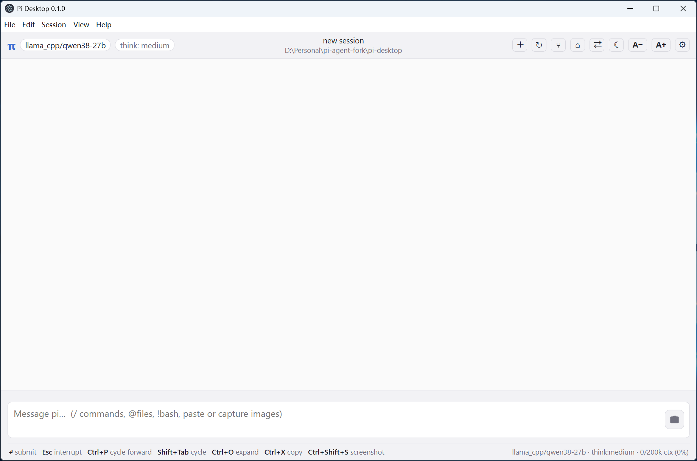

# Pi Desktop

A cross-platform desktop app for the [pi coding agent](https://pi.dev) — the full
`pi` TUI experience in an Electron window, built on the official pi SDK
(`@earendil-works/pi-coding-agent`).



## Documentation

| 文档 | 内容 |
|---|---|
| [docs/architecture.md](docs/architecture.md) | 架构设计:进程模型、安全模型、数据流、主题/键位/扩展桥、打包 |
| [docs/api.md](docs/api.md) | API 参考:`window.pi`、全部 IPC 频道、推送事件、快照对象、共享模块 |
| [docs/installation.md](docs/installation.md) | 安装与部署:开发环境、打包(win/mac/linux)、asar 重打包、FAQ |
| [docs/keybindings.md](docs/keybindings.md) | 快捷键参考(默认绑定表 + 模态框内按键) |

## Features

Everything the interactive TUI does:

- **Chat with the agent** — streaming assistant output, thinking blocks, tool
  calls with live status and expandable results, diff previews, markdown +
  syntax highlighting, queued messages, token/usage footer.
- **Editor** — multiline input, `/command` and `@file` autocomplete, bash mode
  (`!cmd` runs in the shell; `!!cmd` runs but is excluded from LLM context),
  image paste/attach, screen-region capture (camera button at the input's
  right edge or Ctrl+Shift+S: drag a rectangle on any display, preview,
  attach), keybindings (Enter submit, Esc interrupt, Ctrl+P model cycle,
  Shift+Tab thinking cycle, Ctrl+O expand, Ctrl+X copy).
- **All 26 TUI slash commands** — `/settings /model /tree /thinking
  /scoped-models /export /import /share /copy /name /session /changelog
  /hotkeys /fork /clone /trust /login /logout /new /compact /resume /reload
  /help /quit` (+ two easter eggs) — plus desktop additions `/theme <name>`,
  `/debug` and `/workspaces`.
- **Sessions** — persistence in `~/.pi/agent/sessions`, resume picker, session
  tree navigation, fork/clone at any user message, rename, session stats,
  HTML/JSONL export and JSONL import.
- **Workspaces** — every directory is a workspace. On launch (without
  `--cwd`/`--session`) a two-pane picker shows your historical workspaces
  (derived from on-disk sessions, most-recent first) and the sessions of the
  selected one: open a workspace, load any past session (same or other
  project), create a workspace by picking a folder (⌂ titlebar button,
  File ▸ Workspaces…, `/workspaces`), or delete a workspace's sessions with
  two-step confirmation (the current workspace is protected).
- **Models & auth** — full model catalog with search (all providers + local
  llama.cpp models discovered from your pi setup), thinking levels,
  `/login`/`/logout` provider authentication, scoped-model cycling.
- **Themes** — every built-in and custom pi theme (`~/.pi/themes/*.json`)
  rendered as a live CSS-variable palette; `/theme` or the titlebar/settings UI.
- **Extensions & skills** — your pi extensions and skills are loaded through
  the SDK exactly as in the TUI (custom tools, commands, prompts, footers).
- **Native menus & windows** — File/Session/View/Help menus with accelerators,
  open folder as working directory, single-instance lock, external links open
  in the browser.

## Architecture

```
src/
  main/      Electron main process
    index.js   window, menus, CLI args (--cwd, --session, --smoke)
    host.js    AgentHost — wraps the pi SDK runtime, owns all IPC channels
    platform.js
  preload/   contextBridge API (window.pi) — contextIsolation on, no nodeIntegration
  renderer/  the UI
    index.html
    css/main.css       theme system (CSS custom properties)
    js/main.js         commands, state, modals wiring
    js/editor.js       editor + autocomplete + bash mode
    js/transcript.js   message/tool/diff rendering
    js/modals.js       model/settings/theme/tree/help dialogs
    js/workspaces.js   workspace picker (workspaces ↔ sessions)
    js/markdown.js
  shared/    pure, unit-tested helpers
    slash.js  command parsing, bash detection, autocomplete
    theme.js  pi theme JSON -> CSS variable resolution
    diff.js   unified diff -> HTML
    workspaces.js  group on-disk sessions into workspaces
    format.js keys.js tree.js
test/        vitest unit tests + headless SDK smoke test (smoke-host.mjs)
```

The main process hosts the SDK:

```
ModelRuntime.create()
  -> createAgentSessionServices()      (extensions, skills, prompts, themes)
  -> createAgentSessionRuntime()       (session + compaction + tree)
```

All UI actions are IPC invocations into `AgentHost.dispatch()`; session events
(stream deltas, tool updates, compaction, queue) are pushed to the renderer as
they happen.

## Development

```sh
npm install          # installs electron + pi packages (file: links to ../pi)
npm start            # run the app
npm test             # vitest unit tests (81)
node test/smoke-host.mjs   # headless SDK wiring smoke test
```

Useful dev flags: `npm start -- --smoke` (auto-screenshot),
`SMOKE_PROMPT="..." npm start -- --smoke` (drive a real prompt through the UI),
`--cwd <dir>` (working directory), `--session <file>` (resume a session).

## Packaging

Multi-platform config in `electron-builder.yml` (win: nsis + portable,
mac: dmg, linux: AppImage/deb).

```sh
npm run build:win     # NSIS installer + portable exe
npm run build:mac     # dmg (run on macOS)
npm run build:linux   # AppImage + deb (run on Linux)
npm run package:dir   # unpacked dir only (fast, no installer)
```

Icons are generated from `build/icon.png` by `scripts/make-icons.mjs`.

`src/renderer/vendor/highlight.js` is a prebuilt browser bundle of
highlight.js (npm ships no browser build). Regenerate it after upgrading the
dependency:

```sh
npm run vendor:hljs
```

### Note on this machine (Windows, non-admin)

`electron-builder` completes all packaging steps on this machine except the
final `rcedit`/winCodeSign step, because the winCodeSign archive contains
macOS symlinks that Windows 7-Zip cannot materialize without the
`SeCreateSymbolicLinkPrivilege` admin right. To produce a runnable `release
\win-unpacked` app here, use the repack helper:

```sh
npm run repack:asar   # rebuilds resources/app.asar from source + monorepo deps
```

It mirrors the electron-builder `files` pattern, computes the pi packages'
runtime dependency closure across both `node_modules` trees (npm does not
hoist `file:`-linked deps), and fixes the asar header path separators.

## Tests

- `npm test` — 81 unit tests (slash parsing, keybindings, diff rendering,
  theme resolution, tree utilities, workspace grouping, formatting,
  markdown sanitization, IPC channel allow-list).
- `node test/smoke-host.mjs` — headless end-to-end SDK wiring (model runtime,
  session services, runtime, prompts/skills/themes, fork, settings).
- UI smoke: `npm start -- --smoke` with `SMOKE_PROMPT` drives a real prompt
  (including tool calls) through the packaged/dev UI and captures a
  screenshot.
